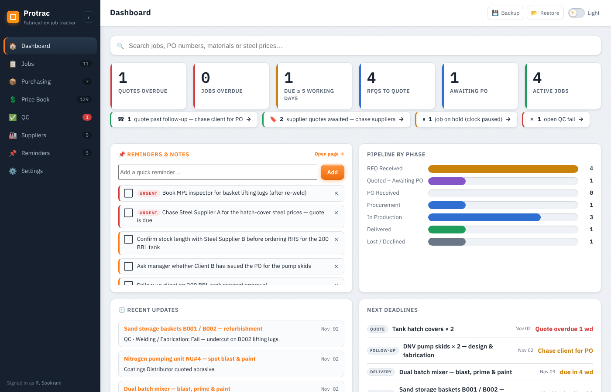
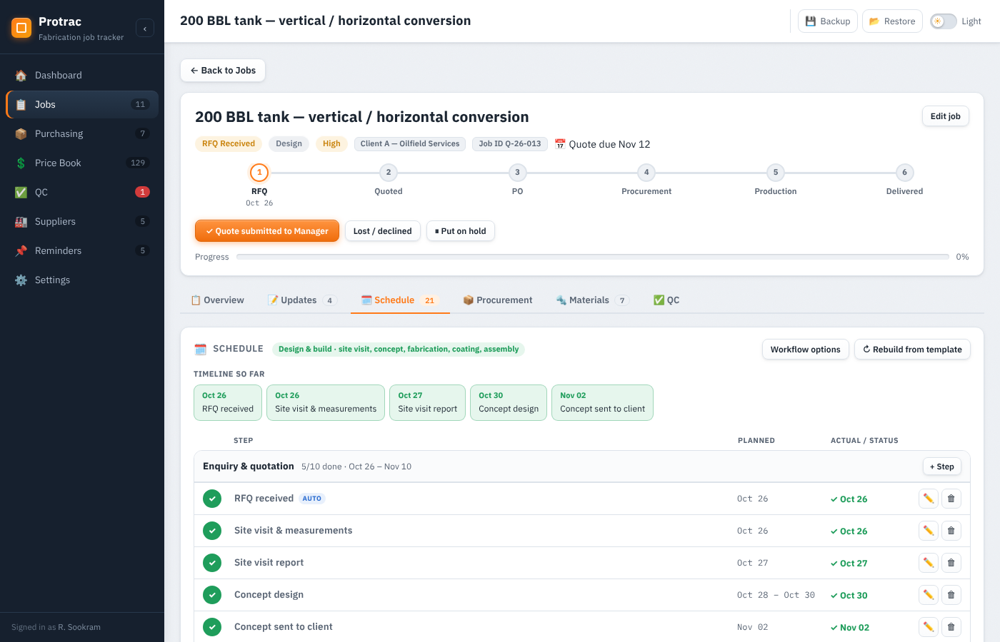
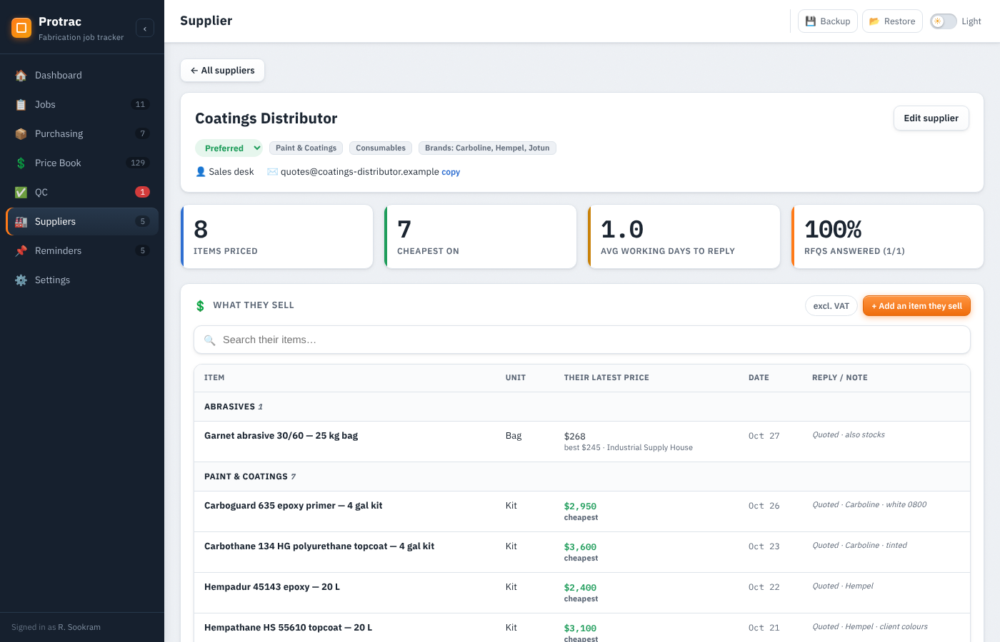
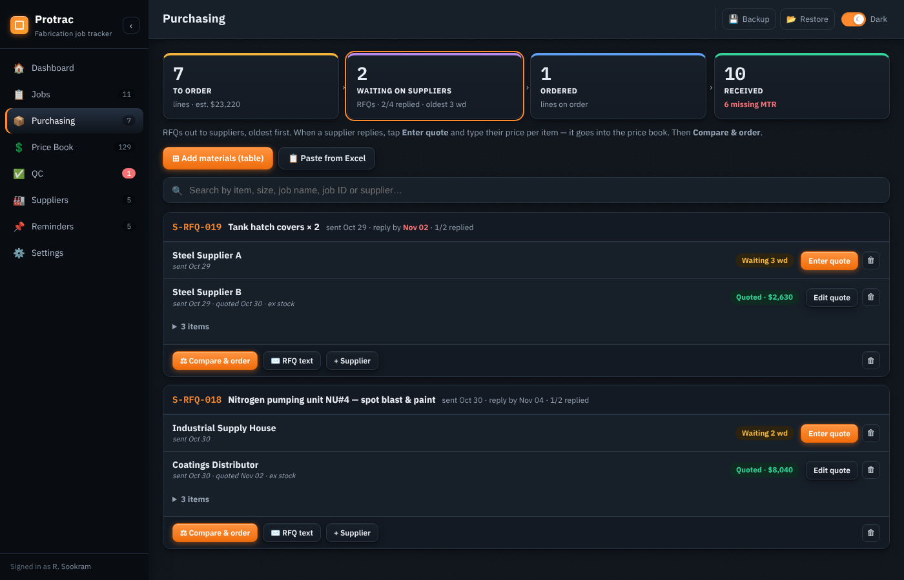
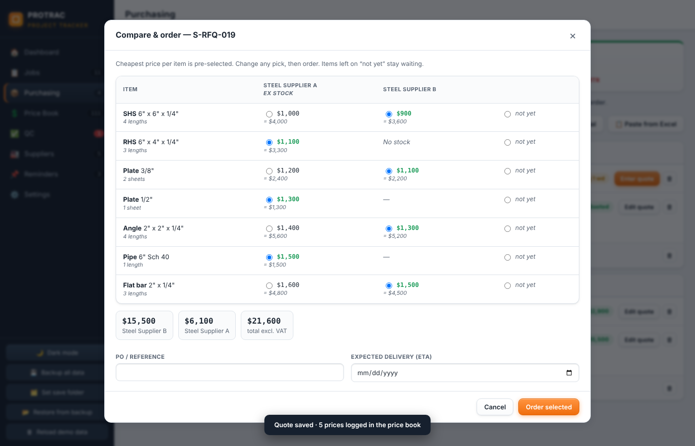
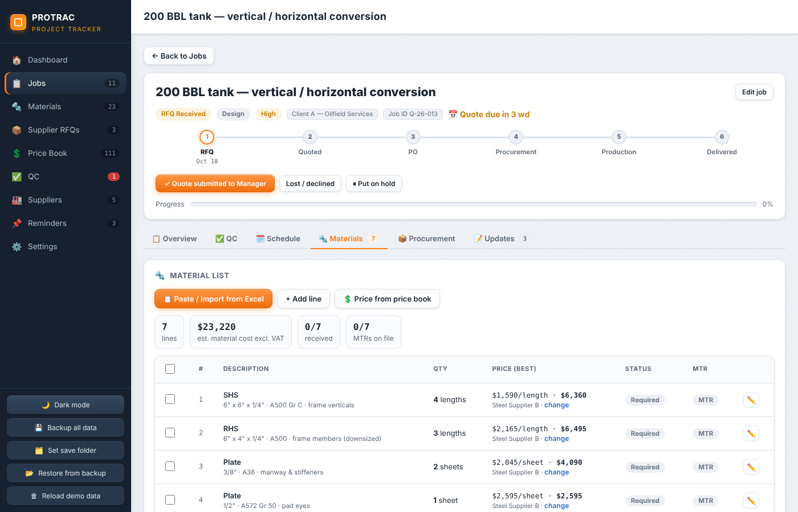
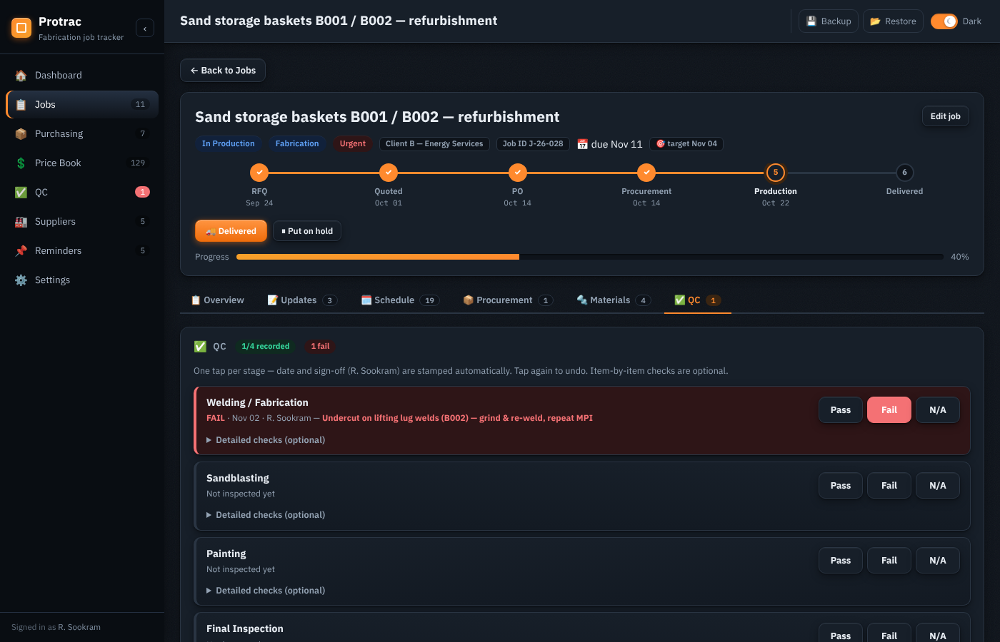
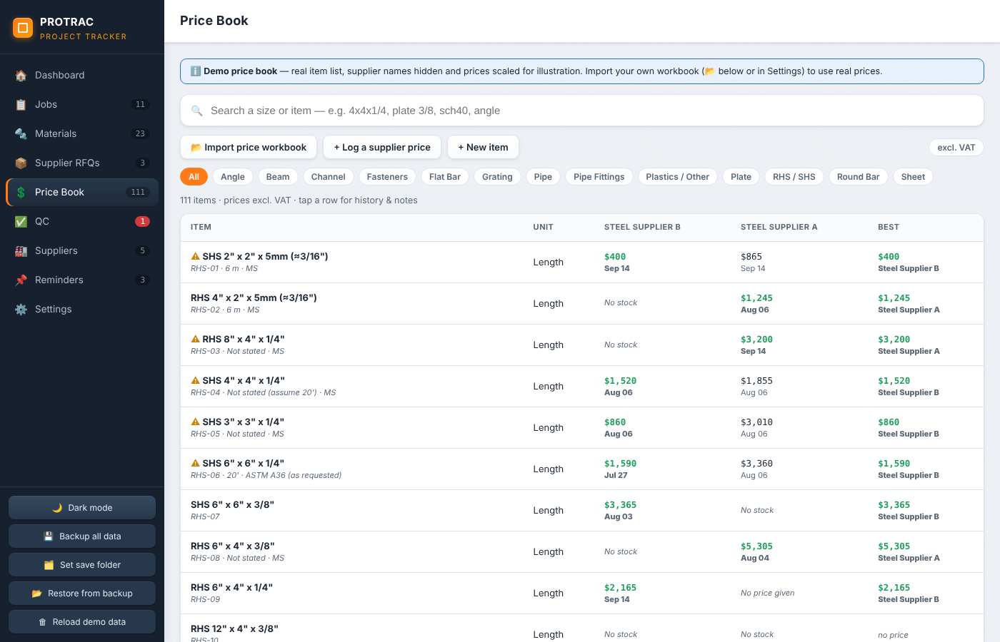
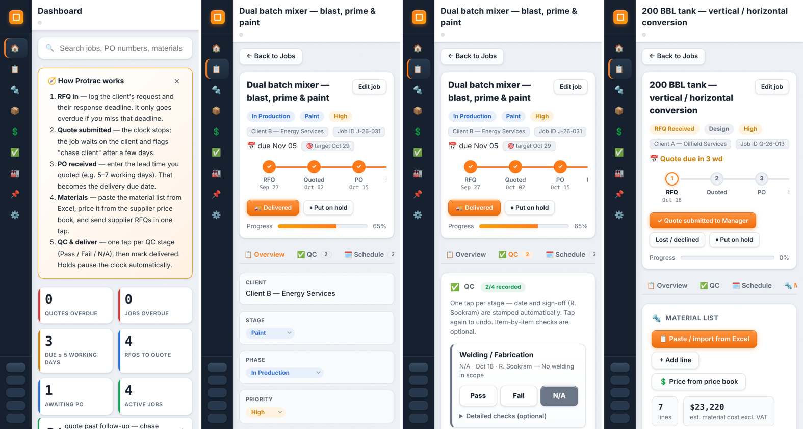

# Protrac — fabrication job tracker

**Live demo:** `https://<your-username>.github.io/protrac/` *(replace after enabling GitHub Pages)*

Protrac tracks a steel-fabrication job from the client's RFQ to delivery: quoting deadlines, purchase orders, material take-offs, supplier RFQs, steel prices and QC sign-off. I built it to replace the spreadsheets, paper QC checklists and memory I was relying on as the only engineer at a fabrication shop in Trinidad.

It is a single offline HTML file. There's no install, no server and no account, and it works on a laptop or a phone.



---

## The problem it solves

| Before | With Protrac |
|---|---|
| One "due date" per job, so jobs showed **overdue while we were waiting on the client** | Each phase has its own clock. Waiting on a PO is never "overdue"; it flags *chase client* instead |
| Lead times quoted in working days, but tracked in calendar days | Due dates count **working days**, skipping weekends and T&T public holidays |
| A job paused for client approval looked late | **Hold** pauses the clock and pushes the due date out by every working day held |
| Material lists retyped from Excel | **Paste straight from Excel**, or import a whole .xlsx including multiple sheets |
| Hunting through supplier emails for the last steel price | **Price book**: every supplier quote logged, with the latest and cheapest price shown on each material line |
| Paper QC checklists | **One tap per QC stage** (Pass / Fail / N/A), date and sign-off stamped automatically |

## How a job moves

```
RFQ received ──► Quote submitted ──► PO received ──► Procurement ──► Production ──► Delivered
 due = client's     clock stops;      due = PO date + quoted lead time (working days)
 reply deadline     "chase client"    min = target, max = due date; holds extend it
```

## Features

- **Dashboard built around actions**: quotes overdue, jobs overdue, due within 5 working days, RFQs to quote, awaiting PO, open QC fails. Every number opens the filtered list.
- **Job templates & auto timeline**: pick the job type (design & build, build to client drawing, repair / blast & paint) and tick what it needs (site visit, concept, fabrication, coating, assembly). Protrac lays out the whole workflow with working-day dates. Steps the app already knows about (quote submitted, PO, materials ordered/received, QC, delivery) tick themselves with the real date, so the schedule becomes a timeline of what actually happened.
- **Fast job entry**: a new job is five fields: name, client, job type (one tap), RFQ date (today) and the client's deadline (3 / 5 / 10 working-day chips). Job numbers run 001, 002, 003… and match the job's folder name ("006. Client A Tank hatch cover").
- **Job page**: progress stepper, next-action button, **undo / redo** of phase changes, progress and current step taken from the schedule, turnaround stats (RFQ → quote, quote → PO, delivery vs. promise).
- **Board**: jobs by phase in full-height lanes; drag a card (or press-and-hold on a phone) to move it on.
- **Automation**: the schedule re-plans itself when the PO and lead time come in; the job moves into production when the last material line is received; QC stages outside the job's scope are marked N/A.
- **Material lists**: type them into a spreadsheet-style table (Enter moves down, paste cells straight from Excel), or import a multi-sheet .xlsx. Lines are priced from the price book as they come in.
- **Purchasing pipeline**: one page with four clickable stages: **To order → Waiting on suppliers → Ordered → Received**.
  - Tick lines and send one RFQ to several suppliers. The RFQ copies as a real email table (keeps its columns in Gmail/Outlook) with blank price and lead-time columns for the supplier to fill in.
  - Enter each supplier's reply per item; prices are logged in the price book automatically.
  - **Compare & order**: suppliers side by side, cheapest pre-selected, totals per supplier.
  - Track ETAs, receive deliveries, and flag missing MTRs.
- **Supplier profiles**: tap a supplier to see everything they sell with their latest prices, the brands they carry, how fast they reply to RFQs and how often they're cheapest. Add a new item they sell (and its price) right there.
- **Price book**: imports an existing supplier costing workbook (Price Book + Quote Log sheets). Search by size (`4x4x1/4`, `plate 3/8`, `sch40`), compare suppliers, view price history and flags. Prices show excl./incl. VAT.
- **QC**:
  - Four stages: Welding/Fabrication, Sandblasting, Painting and Final Inspection.
  - Optional item-by-item checks for each stage.
  - Failed stages carry a defect note.
  - A QC register across all jobs.
- **Also**: search across jobs, materials and prices; reminders; per-job schedule with Gantt; dark mode; JSON backup/restore; CSV export.










## Technical notes

- **One self-contained file**: vanilla JavaScript, no frameworks, no external libraries, works offline. Data stays in the browser (`localStorage`) and is backed up to a JSON file.
- **Excel import without a library**: reads `.xlsx` by unzipping it with the browser's built-in `DecompressionStream` and parsing the sheet XML (shared strings, date formats, multiple sheets).
- **Working-day engine**: weekends plus T&T public holidays, including Easter-based holidays and Sunday → Monday observed rules. Eid and Divali are added per year in Settings.
- **Tested**: an automated sweep that clicks every button, dialog and save path across every page, plus 180+ automated checks in Node (date maths, phase clocks, holds, undo/redo, data migrations from older versions) and 220+ end-to-end checks in headless Chrome (Excel import, price workbook import, purchasing flow, QC, board drag on desktop and touch, phone layout).

## About the demo data

The demo jobs are based on real job *types* I handled. Client names are anonymised and PO numbers are invented. The price book holds **real steel quotes** (TTD, excl. VAT) from two local stockists, with the supplier names replaced by "Supplier A" and "Supplier B".

## Run it

Open `index.html` in Chrome or Edge, or use the live link above. **Settings → Start empty** clears the demo for real use.
